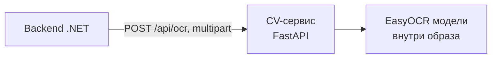
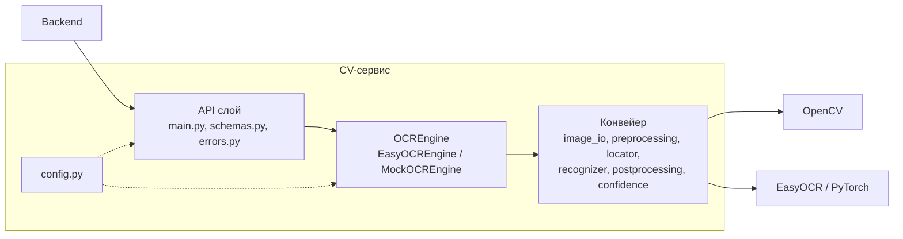
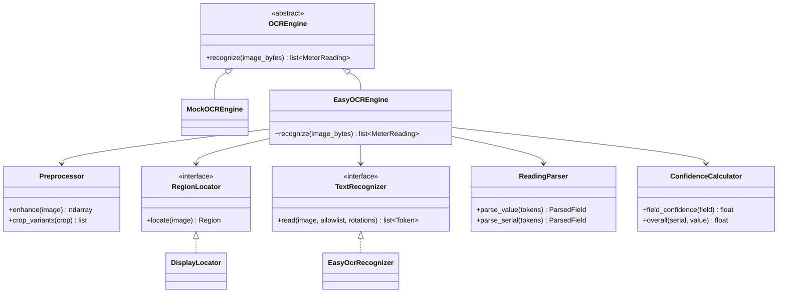
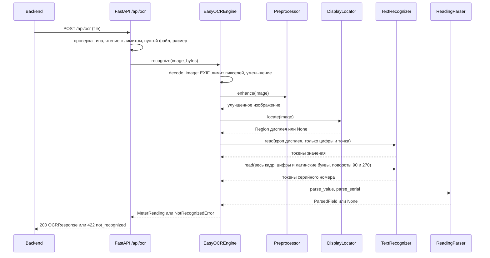

# Архитектура CV-сервиса

## 1. Роль в системе и ответственность



| Сервис делает | Сервис не делает |
|---|---|
| Принимает изображение, проверяет тип, размер, возможность декодирования | Не знает о пользователях, БД и файловом хранилище |
| Находит на фото дисплей и серийный номер, распознаёт их | Не хранит изображения (кроме явного режима отладки) |
| Нормализует результат и считает уверенность по каждому полю | Не аутентифицирует вызовы: доступен только из внутренней сети |
| Возвращает ошибку `not_recognized`, если данных нет | Не решает, подтвердил ли пользователь значение |

Сервис не хранит состояние между запросами и масштабируется добавлением контейнеров.

### Где выполняется распознавание

ТЗ фиксирует схему «приложение → backend → CV-сервис на Python (EasyOCR + OpenCV)», то есть распознавание выполняется **на сервере**. Документация исходит из этого. Для сравнения, что дало бы распознавание на телефоне:

| | На сервере (по ТЗ) | На телефоне |
|---|---|---|
| Технологии | EasyOCR + OpenCV, как в ТЗ | EasyOCR во Flutter не запускается. Пришлось бы менять движок (TFLite, ONNX, ML Kit) и переписывать конвейер |
| Обновление модели и правил | Выкладка сервера, без релиза приложения | Только вместе с релизом приложения |
| Качество и отладка | Одна среда, можно собрать датасет и воспроизвести ошибку | Разные телефоны и камеры, ошибки труднее воспроизвести |
| Нагрузка на устройство | Нет | Батарея, память, размер приложения. Слабые устройства (Android 8+, iOS 13+) |
| Сеть | Нужна, фото размером порядка нескольких МБ уходит на сервер | Распознавание работает без сети |
| Приватность | Backend по ТЗ всё равно сохраняет оригинал фото на сервере | Фото всё равно уходит на сервер при подтверждении, выигрыш небольшой |

Решение команды: распознавание выполняется на сервере. На телефоне разумно делать только лёгкую проверку перед отправкой (рамка для наведения, резкость, блики), чтобы пользователь сразу переснимал.

## 2. Компоненты



Правила зависимостей:

1. `main.py` знает только интерфейс `OCREngine` и схемы. Какой движок подключён, решает `factory.py` по настройке `USE_MOCK`.
2. Модули конвейера не знают о FastAPI. Их можно запускать из скрипта оценки качества.
3. Единственная точка контакта с EasyOCR: `recognizer.py`. Единственная точка контакта с декодированием файла: `image_io.py`.
4. `postprocessing.py` и `confidence.py`: чистые функции без OpenCV и EasyOCR. Тестируются без моделей и без картинок.
5. `schemas.py` описывает только внешний контракт. Внутренние структуры (`Region`, `Token`, `ParsedField`) лежат в `models.py`.

## 3. Структура кода

```
cv/
├── README.md
├── requirements.txt
├── run_mock.bat
├── scripts/
│   └── evaluate.py                оценка качества на датасете (новое)
├── tests/
│   ├── test_postprocessing.py     без моделей (новое)
│   ├── test_api.py                TestClient + MockOCREngine (новое)
│   └── data/                      эталонные фото и labels.csv (новое)
└── app/
    ├── main.py                    FastAPI: маршруты, обработчики ошибок, lifespan   (есть, расширяется)
    ├── config.py                  настройки из окружения                            (есть, расширяется)
    ├── schemas.py                 BoundingBox, MeterReading, OCRResponse, ErrorBody (есть, расширяется)
    ├── errors.py                  CvError, InvalidImageError, NotRecognizedError    (новое)
    ├── models.py                  Region, Token, ParsedField, RegionKind            (новое)
    ├── engine/
    │   ├── base.py                OCREngine                                         (есть)
    │   ├── mock_engine.py         MockOCREngine                                     (есть, расширяется)
    │   ├── easyocr_engine.py      EasyOCREngine, оркестратор конвейера              (новое)
    │   └── factory.py             create_engine(settings)                           (новое)
    └── pipeline/
        ├── image_io.py            decode_image, ограничения, масштаб                 (новое)
        ├── preprocessing.py       Preprocessor: контраст, блики, варианты кропа      (новое)
        ├── locator.py             DisplayLocator                                    (новое)
        ├── recognizer.py          TextRecognizer, EasyOcrRecognizer                 (новое)
        ├── postprocessing.py      ReadingParser                                     (новое)
        └── confidence.py          ConfidenceCalculator                              (новое)
```

Документация лежит вне папки `cv/`: `docs/developer/`.

## 4. Классы и интерфейсы



| Компонент | Назначение |
|---|---|
| `OCREngine` (есть) | Контракт движка: `recognize(image_bytes) -> list[MeterReading]`. Бросает `InvalidImageError` и `NotRecognizedError` |
| `MockOCREngine` (есть) | Заглушка. Предлагается научить её сценариям ошибки, см. [api.md](api.md#7-заглушка-и-тестовые-сценарии) |
| `EasyOCREngine` | Оркестратор. Получает зависимости через конструктор (удобно подменять в тестах), выполняет шаги 1–8 из раздела 5, переводит координаты обратно в систему исходного изображения |
| `Preprocessor` | `enhance`: выравнивание контраста и подавление бликов на кадре. `crop_variants`: несколько вариантов подготовленного кропа дисплея для распознавания, см. [preprocessing.md](preprocessing.md) |
| `RegionLocator` / `DisplayLocator` | Ищет прямоугольник дисплея классическими методами OpenCV. Возвращает `Region` или `None` |
| `TextRecognizer` / `EasyOcrRecognizer` | Обёртка над `easyocr.Reader`. Принимает изображение, `allowlist` и углы поворота, возвращает `Token`. Reader создаётся один раз |
| `ReadingParser` | Из токенов выбирает кандидата значения и кандидата серийного номера, чистит символы, проверяет формат, нормализует разделители |
| `ConfidenceCalculator` | Считает уверенность по полю и общую, см. [recognition.md](recognition.md#7-оценка-уверенности) |
| `Region` | `kind` (`display` или `full`), `bbox`, `source` (способ нахождения) |
| `Token` | Результат EasyOCR: `text`, `confidence`, `bbox`, `rotation`, `variant` |
| `ParsedField` | Выбранное поле: `value`, `confidence`, `bbox`, `flags` (например `substituted`, `point_restored`, `fallback_region`) |
| `NotRecognizedError(missing)` | Бросается, если не найдено значение и/или серийный номер. Содержит список недостающих полей |
| `InvalidImageError` | Файл не удалось декодировать или он слишком большой по числу пикселей |

## 5. Поток обработки



Шаги `EasyOCREngine.recognize`:

1. `decode_image` (ошибка → `InvalidImageError`).
2. `Preprocessor.enhance` на уменьшенном кадре.
3. `DisplayLocator.locate`. Если дисплей не найден, значение ищется среди токенов полного кадра и поле получает флаг `fallback_region`.
4. Распознавание кропа дисплея (по каждому варианту из `crop_variants`), выбор лучшего.
5. Полнокадровый проход для серийного номера, токены внутри дисплея исключаются.
6. `ReadingParser`: выбор кандидатов, нормализация, проверка формата.
7. Если значения или серийного номера нет, то `NotRecognizedError(missing=[...])`.
8. Оценки уверенности, перевод `bbox` в координаты исходного изображения, сборка `MeterReading`.

Подробности выбора кандидатов и правил в [recognition.md](recognition.md).

## 6. Производительность и конкурентность

Backend ждёт ответ не дольше 4 с (общий бюджет по ТЗ 5 с). Целевой бюджет по этапам (допущение, проверить измерением):

| Этап | Бюджет |
|---|---|
| Приём, проверки, декодирование, уменьшение | ≤ 0,2 с |
| Предобработка кадра | ≤ 0,3 с |
| Поиск дисплея | ≤ 0,5 с |
| EasyOCR (кроп + полный кадр) | ≤ 2,5 с |
| Постобработка и уверенность | ≤ 0,1 с |
| Запас | 0,4 с |

Железо сервера пока неизвестно, поэтому бюджет рассчитан на худший случай (только CPU) и обязательно проверяется замером на целевом сервере. Самый рискованный этап: полнокадровый проход EasyOCR с поворотами на CPU. Меры, если не укладывается: уменьшить `MAX_SIDE_PX`, распознавать серийный номер только в найденных текстовых блоках, включить GPU, сузить повороты. Решение принимать по результатам `scripts/evaluate.py`.

Особенности исполнения:

- `EasyOCREngine.recognize` синхронный и CPU-тяжёлый. В `async`-эндпоинте он не должен выполняться напрямую (блокирует event loop и `/health`). Эндпоинт объявляется как `def` (FastAPI запустит его в пуле потоков) или вызов оборачивается в `run_in_threadpool`.
- Число одновременных распознаваний ограничено семафором `MAX_CONCURRENT_RECOGNITIONS` (по умолчанию 1). Остальные запросы ждут очереди, при переполнении отвечать быстро (доработка после замеров). Потокобезопасность `easyocr.Reader` не гарантируется, поэтому доступ к нему защищён.
- Модели загружаются в `lifespan` при старте, затем выполняется прогревочное распознавание на пустом кадре. До окончания прогрева `GET /health` отвечает `503`, и backend не отправляет запросы.
- Масштабирование: несколько контейнеров (процессов) за балансировщиком, один воркер `uvicorn` на контейнер.

## 7. Безопасность и приватность

| Риск | Мера |
|---|---|
| Файл, который в сжатом виде мал, а в распакованном огромный (decompression bomb) | Проверка размеров до полного декодирования и лимит `MAX_IMAGE_PIXELS`, при превышении `invalid_image` |
| Подмена `Content-Type` | Тип проверяется по заголовку части multipart (как сейчас). Рекомендуется дополнительно проверять сигнатуру JPEG/PNG |
| Доступ извне | Порт не публикуется наружу, сервис доступен только из внутренней сети. Аутентификации нет |
| Хранение чужих фото | Изображения не пишутся на диск и не логируются. Исключение: `DEBUG_SAVE_DIR`, только для разработки и с очисткой |
| Запуск от root | Контейнер запускается под обычным пользователем |
| Загрузка моделей из интернета при старте | Модели лежат в образе (`EASYOCR_MODEL_DIR`), загрузка отключена |

## 8. Развёртывание

| Параметр | Значение |
|---|---|
| Образ | Python 3.11+ (требование ТЗ), `opencv-python-headless`, EasyOCR с CPU-сборкой PyTorch (если нет GPU) |
| Запуск | `uvicorn app.main:app --host 0.0.0.0 --port 8000`, без `--reload`, один воркер |
| Сеть | Внутренняя сеть docker-compose, порт наружу не публикуется |
| Health check | `GET /health` (готовность после прогрева) |
| Ресурсы | Железо пока неизвестно, проектируем под худший случай (только CPU). Лимиты памяти и CPU задать после замеров на целевом сервере (вопрос №2 в [README](README.md#открытые-вопросы)) |

Подробнее в [configuration.md](configuration.md).
