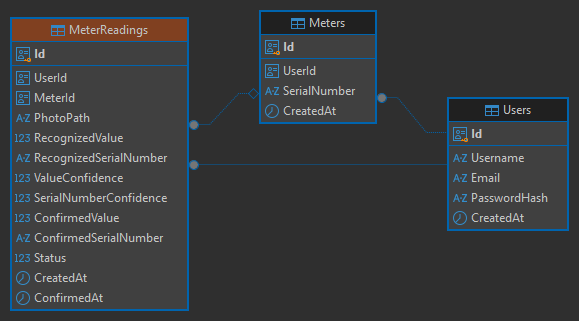

# Схема БД

База данных - PostgreSQL.

Классы таблиц лежат в `backend/api/Database/Models`, класс для работы с базой (контекст) - в `backend/api/Database/AppDatabase.cs`.

## Таблицы

### Users (пользователи)

- `Id` - id пользователя
- `Username` - логин
- `Email` - почта
- `PasswordHash` - хеш пароля
- `CreatedAt` - когда создан

### Meters (счетчики)

- `Id` - id счетчика
- `UserId` - id пользователя, чей это счетчик
- `SerialNumber` - серийный номер
- `CreatedAt` - когда добавлен

### MeterReadings (показания)

- `Id` - id показания
- `UserId` - id пользователя, который передал показание
- `MeterId` - id счетчика (может быть пустым, если счетчик еще не выбран)
- `PhotoPath` - путь к фото
- `RecognizedValue` - значение, которое распознал CV
- `RecognizedSerialNumber` - серийный номер, который распознал CV
- `ValueConfidence` - уверенность распознавания значения
- `SerialNumberConfidence` - уверенность распознавания номера
- `ConfirmedValue` - значение, которое подтвердил пользователь
- `ConfirmedSerialNumber` - серийный номер, который подтвердил пользователь
- `Status` - статус показания (значения ниже)
- `CreatedAt` - когда создано
- `ConfirmedAt` - когда подтверждено

Статусы (`ReadingStatus`):

- `0` - ожидает подтверждения
- `1` - подтверждено
- `2` - отменено

## Связи между таблицами



**Пользователь и счетчики.** У одного пользователя может быть несколько счетчиков. Но у каждого счетчика только один пользователь. Чей это счетчик, записано в поле `UserId` в таблице `Meters`.

**Пользователь и показания.** Пользователь может передавать показания с разных счетчиков. Какой именно пользователь передал показание, записано в поле `UserId` в таблице `MeterReadings`.

**Счетчик и показания.** С одного счетчика можно снять много показаний. Каждое показание относится к одному счетчику. К какому, записано в поле `MeterId` в таблице `MeterReadings`.

**Примечание:** нельзя добавить счетчик пользователю, которого нет в таблице `Users`. Если удалить пользователя, удалятся и его счетчики с показаниями.

## Как поднять БД

Нужен установленный PostgreSQL.

1. Установить инструмент для миграций (нужно только один раз):

```
dotnet tool install --global dotnet-ef
```

2. Открыть терминал и сначала задать путь к папке `backend/api` а после выполнить:

```
dotnet ef database update
```

В файле `backend/api/appsettings.Development.json` лежит строка подключения (`ConnectionStrings`), в ней `Username=postgres` и `Password=postgres`.
